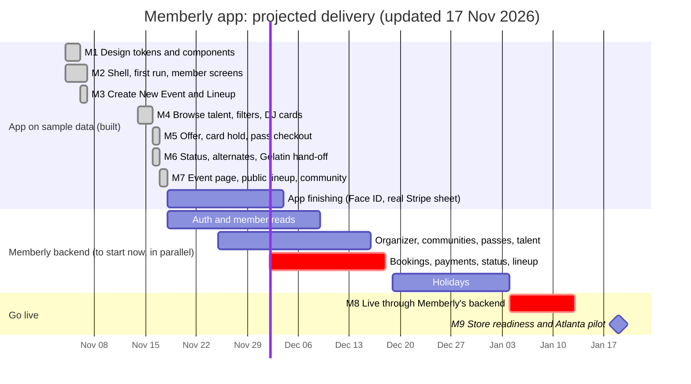

# Memberly native app

The Memberly app for iPhone (Android to follow), built in React Native with Expo. Members find what's on tonight, get passes and show their Memberly Card at the door. Organizers run their community, create events and book DJs from Gelatin in the **Lineup** section of Create New Event.

**Status, 17 Nov 2026:** every app milestone through M7 runs on the iPhone with sample data, two months ahead of the original plan. Members can find events, read the redesigned event page with its Gelatin lineup, open a community's page, get a pass, show their Memberly Card and share a referral link. Organizers can start a community (with membership tiers), set up passes, create an event, browse DJs, send offers, hold a card and follow each booking live. Four test accounts cover each stage (see Test accounts in `app/README.md`). Payments and the Gelatin portal use labelled test stand-ins until the backend can issue sessions and launches. Nothing talks to a live service yet.

## Where to look

| What | Where |
| -- | -- |
| The app (Expo SDK 58, React Native 0.88, TypeScript, Expo Router) | [`app/`](app/), setup in [`app/README.md`](app/README.md) |
| Product truth: who it's for, the booking rules, decisions | [`PRODUCT.md`](PRODUCT.md) |
| Design system: tokens, components, motion | [`DESIGN.md`](DESIGN.md), and the live Storybook at [memberly-design-system.vercel.app](https://memberly-design-system.vercel.app/?path=/docs/start-here--docs) (`npm run storybook` in `app/`) |
| Screenshots by milestone | [`app/docs/screenshots/`](app/docs/screenshots/) |
| Design boards (static HTML) and the welcome video source | [`design/`](design/) |
| Plan, user stories and acceptance criteria | Linear project "Memberly Native App · React Native" |

## Run it

```bash
cd app
npm install
npx expo run:ios        # builds the development app into the iPhone simulator
npx expo start --dev-client
```

Sign-in is fake until the backend exists: any email works, code `1234` signs in, `0000` shows the expired message. Set `EXPO_PUBLIC_FAKE_SIGNED_IN=1` to skip sign-in. Checks: `npx tsc --noEmit`, `npx expo lint`, `npx jest` (every screen and every Storybook story).

## Projected delivery



| Milestone | Was | Now | Where it stands |
| -- | -- | -- | -- |
| M1 Design tokens and shared components | 13 Nov | 6 Nov | **Built**. Published as the Memberly Design System |
| M2 App shell, first run, member screens | 27 Nov | 7 Nov | **Built**. Face ID and token refresh are part of "App finishing" |
| M3 Create New Event with the Lineup section | 4 Dec | 7 Nov | **Built** |
| M4 Browse talent, filters and DJ cards | 11 Dec | 16 Nov | **Built** |
| M5 Offer and card hold, native pass checkout | 18 Dec | 17 Nov | **Built** on a test payment sheet. The real Stripe sheet needs one answer from Gelatin (below) |
| M6 Status, alternates and the Gelatin hand-off | 8 Jan | 17 Nov | **Built**. Withdrawing open offers on a date change waits on the Partner API |
| M7 Event page and public lineup | 15 Jan | 17 Nov | **Built**, with the redesigned event page, the community page and Referrals |
| Also built, not in the original plan | | 17 Nov | Create community (story, look, discovery, membership tiers), Add a pass, the Home "+" button, test accounts, the published design system |
| M8 Live through Memberly's backend (test mode) | 29 Jan | **13 Jan** | Swaps the sample data for the HTTP repository; no screen changes. Needs the backend endpoints |
| M9 Store readiness and the Atlanta pilot | 12 Feb 2027 | **19 Jan 2027** | TestFlight, App Store review, pilot in one Atlanta community |

**What sets the date now.** The app is done on sample data, so the pilot moves from **12 Feb to 19 Jan 2027**, about four weeks sooner. What's left sits outside the app:

1. **Memberly's backend endpoints.** Auth, member reads (now including the event page details, the community page and referrals), organizer events, communities and passes, and the talent, booking and status proxies. Every one is specified in Linear with acceptance criteria. Starting this week lands them before the holidays; each week's slip moves the pilot by a week.
2. **One answer from Gelatin:** what `payment-sessions` returns for the native Stripe payment sheet (a PaymentIntent client secret, the publishable key and the account). The app and backend won't build against a guessed shape.
3. **Referral terms.** What referrals earn and when it's paid, before the app shows any amounts.

Android is paused until the iPhone app is finished. The Android SDK and an emulator are already set up, so it can start without setup time.

## How it fits together

- The app talks **only to Memberly's backend**. Memberly's backend holds the Gelatin Partner API key and proxies every Gelatin call. The app never holds a secret.
- Every screen reads through one `MemberlyRepository` interface. M1–M7 run on a fake implementation; M8 swaps in an HTTP implementation with no screen changes.
- Booking status comes from polling every 5 seconds, and only while a DJ is deciding. No webhooks, no embeds.
- The app shows the server's totals and never adds amounts up itself.
