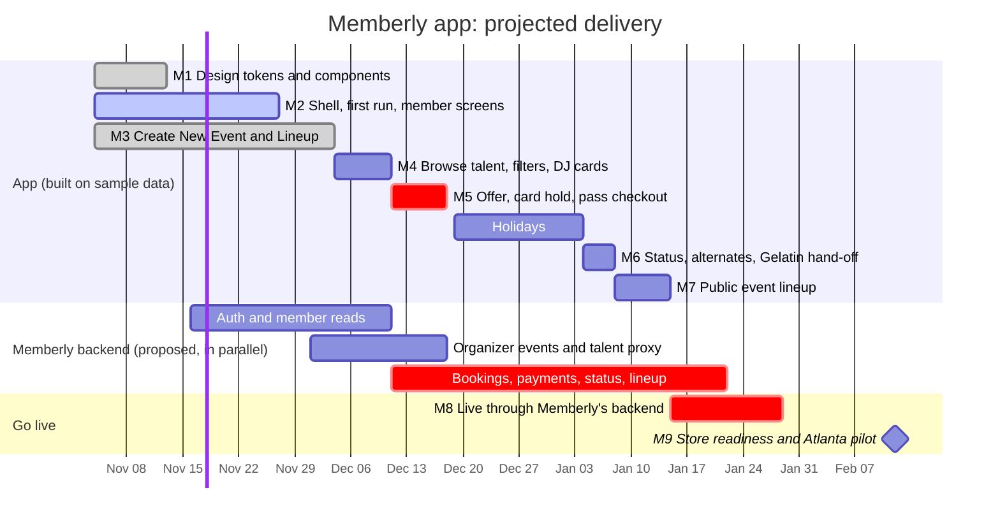

# Memberly native app

The Memberly app for iPhone (Android to follow), built in React Native with Expo. Members find what's on tonight, get passes and show their Memberly Card at the door. Organizers run their community, create events and book DJs from Gelatin in the **Lineup** section of Create New Event.

**Status, 6 Nov 2026:** milestones 1–3 run on the iPhone simulator with sample data. The organizer booking flow is in place up to the point where it calls the real backend. Nothing talks to a live service yet.

## Where to look

| What | Where |
| -- | -- |
| The app (Expo SDK 58, React Native 0.88, TypeScript, Expo Router) | [`app/`](app/), setup in [`app/README.md`](app/README.md) |
| Product truth: who it's for, the booking rules, decisions | [`PRODUCT.md`](PRODUCT.md) |
| Design system: tokens, components, motion | [`DESIGN.md`](DESIGN.md) |
| Screenshots by milestone | [`app/docs/screenshots/`](app/docs/screenshots/) |
| Design boards (static HTML) and the welcome video source | [`design/`](design/) |
| Plan, user stories and acceptance criteria | Linear project "Memberly Native App · React Native" |

## Run it

```bash
cd app
npm install
npx expo run:ios        # builds the development app into the iPhone simulator
npx expo start --dev-client
```

Sign-in is fake until the backend exists: any email works, code `1234` signs in, `0000` shows the expired message. Set `EXPO_PUBLIC_FAKE_SIGNED_IN=1` to skip sign-in. Checks: `npx tsc --noEmit`, `npx expo lint`, `npx jest` (133 tests).

## Projected delivery



| Milestone | Target | Where it stands |
| -- | -- | -- |
| M1 Design tokens and shared components | 13 Nov | **Built**, in review |
| M2 App shell, first run, member screens | 27 Nov | **Screens built** (Welcome with motion and video, sign-in, preferences, Home, Explore, Events, Card, Me). Face ID and token refresh to do |
| M3 Create New Event with the Lineup section | 4 Dec | **Built**, in review |
| M4 Browse talent, filters and DJ cards | 11 Dec | Next |
| M5 Offer and card hold, native pass checkout | 18 Dec | Needs one answer from Gelatin (below) |
| M6 Status, alternates and the Gelatin hand-off | 8 Jan | |
| M7 Public event lineup | 15 Jan | |
| M8 Live through Memberly's backend (test mode) | 29 Jan | Needs the backend endpoints |
| M9 Store readiness and the Atlanta pilot | **12 Feb 2027** | |

**What sets the date.** The app is about three weeks ahead of plan on sample data. Pilot readiness on **12 Feb 2027** now depends on two things outside the app:

1. **Memberly's backend endpoints** (auth, member reads, organizer events, and the talent, booking and status proxies). They're specified in Linear with acceptance criteria, and need to start by mid-November to land before M8.
2. **One answer from Gelatin before M5:** what `payment-sessions` returns for the native Stripe payment sheet (a PaymentIntent client secret, the publishable key and the account). The app and backend won't build against a guessed shape.

Android is paused until the iPhone app is finished. The Android SDK and an emulator are already set up, so it can start without setup time.

## How it fits together

- The app talks **only to Memberly's backend**. Memberly's backend holds the Gelatin Partner API key and proxies every Gelatin call. The app never holds a secret.
- Every screen reads through one `MemberlyRepository` interface. M1–M7 use a fake implementation; M8 swaps in an HTTP implementation with no screen changes.
- Booking status comes from polling every 5 seconds, and only while a DJ is deciding. No webhooks, no embeds.
- The app shows the server's totals and never adds amounts up itself.
